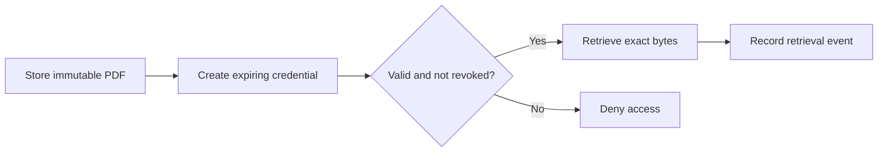

# Deck Post · development core

**An open-source alternative for DocSend PDF-sharing workflows, in preparation.**

Local authenticated API preview. No browser workspace, hosted demo or public release yet.



Implemented: immutable SQLite PDF storage, hashed per-link credentials, UTC expiry, scoped revocation and simple retrieval counts. Links expire at the specified instant, not after it. Metadata reads do not increment retrieval counts. Owner methods are protected by the included HTTP service.

```sh
python3 -m venv .venv
. .venv/bin/activate
pip install -r requirements.txt
python -m unittest discover -s tests -v
```

Use Python 3.12 on Linux. PDFs are limited to 10 MiB, unencrypted, 1–100 pages; total stored files are capped at 100 MiB. PDF checks run in a separate process with a 256 MiB address-space limit, 3-second CPU limit and 5-second parent timeout. This is structural validation, not sanitization, antivirus scanning or a sandbox. The worker is reused from our MIT Approval Folio component.

Expiry and revocation prevent future retrieval; they cannot erase copies already obtained or stop an already authorized transfer. Retrieval events show that bytes were returned by the library, not successful network delivery or human reading. They are not unique visitors, verified identities or page-level engagement analytics. No client IP addresses or emails are collected by the core. PDFs are attachment-only in the local API; no download prevention or full DocSend parity is promised.

Next: visual owner/client workspace, six languages and browser/deployment recovery acceptance. [Scope and evidence](docs/SCOPE.md) · [MIT license](LICENSE).

[Run the authenticated API](docs/API.md). Eighteen tests cover core behavior and HTTP upload/download/authentication, exact expiry, revocation, request limits, full attachments and retrieval-count semantics.
