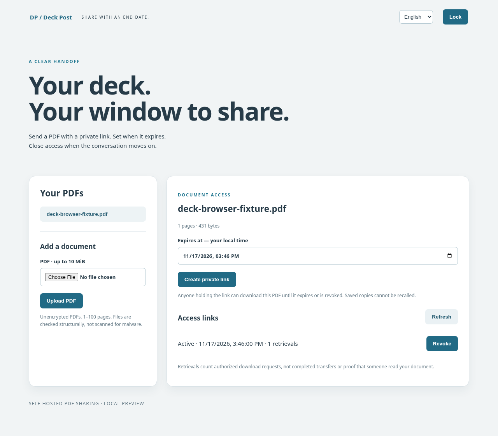

# Deck Post

### Share a PDF. Set an expiry. Stay in control.

Give each recipient a private PDF link with an expiry date and revocation controls. A focused, self-hosted alternative to DocSend for simple PDF sharing.

[](https://github.com/anshuman-pandey/deck-post/actions/workflows/check.yml) · [MIT license](LICENSE) · Python + SQLite · Self-hosted



**Public source preview.** The local workflow and container recovery have been tested. There is no hosted demo or tagged product release yet; public HTTPS acceptance remains pending.

## How it works

1. Upload a PDF to your private workspace.
2. Create a private link with an expiry date and share it with your recipient.
3. Review authorized download-request counts and revoke the link when access should end.

## Try it locally

Requires Git, Python 3 and Docker with the Compose plugin.

```sh
git clone https://github.com/anshuman-pandey/deck-post.git
cd deck-post
python3 scripts/setup.py
docker compose up --build -d
```

Open **http://127.0.0.1:8099**. Read the generated private `.env` file locally and use its `DECK_OWNER_KEY` value to unlock the owner workspace. Setup retains any existing `.env`; do not commit or share this file.

The app binds to localhost and stores data in a persistent Docker volume. Links pointing to localhost work only on your computer. For remote sharing, follow the [HTTPS deployment and backup guide](docs/DEPLOYMENT.md). Avoid `docker compose down -v` unless you intend to delete the stored data.

## Included

- Immutable PDF uploads and independently revocable sharing links.
- Hashed link secrets, with expiry enforced on retrieval.
- Persistent files and access records backed by SQLite.

**Interface languages:** English, German, Spanish, Japanese, Simplified Chinese and Traditional Chinese. Native-speaker review is still pending. User-authored content is never translated.

## Know the boundaries

PDFs are limited to 10 MiB each, 100 MiB total storage and 1–100 unencrypted pages. Counts measure authorized retrieval requests, not completed downloads, unique people or proof of reading. Revocation cannot recall saved copies or stop an already authorized transfer. Bounded structural PDF checks are not malware scanning. No page analytics, identity verification, signatures or download prevention.

Private links and reviewer keys grant access to whoever holds them. Keep the owner key separate from participant credentials. This project covers the workflow above, not the full feature set of its commercial reference.

## Development and checks

```sh
python3 -m venv .venv
. .venv/bin/activate
pip install -r requirements.txt
python -m unittest discover -s tests -v
```

The published baseline passed **18 Python tests**. Recorded browser acceptance covers: pdf upload/download, expiry, independent link revocation and request counting. Container restart and clean-volume backup/restore were also checked. See the [validation record](artifacts/validation.json) for the exact evidence and remaining acceptance gates.

Bug reports should include reproduction steps and browser/runtime versions, with private keys and client data removed. Focused fixes and improvements are welcome through [issues](https://github.com/anshuman-pandey/deck-post/issues) and pull requests.

## Documentation

[Deployment & backups](docs/DEPLOYMENT.md) · [Api guide](docs/API.md) · [Scope & comparison](docs/SCOPE.md) · [Validation evidence](artifacts/validation.json) · [License](LICENSE)

## Current verification

See the [26 November audit checkpoint](docs/AUDIT.md) for the verified repository, release links, fresh core test result and remaining deployment/browser gates. Earlier validation records remain dated evidence.
