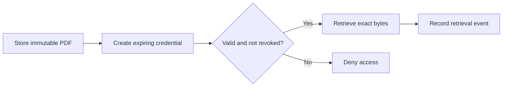

# Deck Post

**An open-source alternative for DocSend PDF-sharing workflows, in preparation.**

**Share a PDF with an expiry date. Revoke future access when the conversation moves on.**

Local English browser preview; no hosted demo or public release yet.




Implemented: immutable SQLite PDF storage, hashed per-link credentials, UTC expiry, scoped revocation and simple retrieval counts. Links expire at the specified instant, not after it. Metadata reads do not increment retrieval counts. Owner methods are protected by the included HTTP service.

```sh
python3 -m venv .venv
. .venv/bin/activate
pip install -r requirements.txt
python -m unittest discover -s tests -v
```

Use Python 3.12 on Linux. PDFs are limited to 10 MiB, unencrypted, 1–100 pages; total stored files are capped at 100 MiB. PDF checks run in a separate process with a 256 MiB address-space limit, 3-second CPU limit and 5-second parent timeout. This is structural validation, not sanitization, antivirus scanning or a sandbox. The worker is reused from our MIT Approval Folio component.

Expiry and revocation prevent future retrieval; they cannot erase copies already obtained or stop an already authorized transfer. Retrieval events show that bytes were returned by the library, not successful network delivery or human reading. They are not unique visitors, verified identities or page-level engagement analytics. No client IP addresses or emails are collected by the core. PDFs are attachment-only in the local API; no download prevention or full DocSend parity is promised.

Next: six languages and deployment/recovery acceptance. [Scope and evidence](docs/SCOPE.md) · [MIT license](LICENSE).

[Run the authenticated API](docs/API.md). Eighteen tests cover core behavior and HTTP upload/download/authentication, exact expiry, revocation, request limits, full attachments and retrieval-count semantics.

## Try the browser preview

Follow [local setup](docs/API.md), then open http://127.0.0.1:8099. Enter your owner key, upload a PDF, select it, set an expiry, and create a private link. Copy the link into a separate browser tab to download. Refresh the owner view to see retrieval requests; use Revoke to deny future requests.

Link secrets live in the URL fragment, which the recipient page clears after loading. Keys remain in memory and are not saved to browser storage. Keep the original private link to reopen it; refreshing a recipient page after its fragment was cleared requires that original link. Anyone holding it has access until expiry or revocation. Run on localhost for now; deployment and HTTPS acceptance are pending.

## Browser verification

With a disposable server/database running and Node.js, Playwright and Chromium installed:

```sh
DECK_TEST_KEY="$DECK_OWNER_KEY" PYTHON=python3 node scripts/browser.cjs
```

Override `DECK_URL` or `CHROMIUM` when needed. This test creates documents and links in the test database. Chromium acceptance covers upload, private-link creation, exact PDF bytes, metadata exclusion from counts, retrieval counts, revocation, real-time expiry and a 390px layout. Python tests cover authorization boundaries and malformed requests. No production deployment is claimed.
